# LAPORAN PRAKTIKUM - WEEK 7 PEMROGRAMAN MOBILE

## Identitas Mahasiswa

| Keterangan | Detail |
|---|---|
| Nama | Mufliha Hafsyah Shahieza |
| NIM | 244107020147 |
| Kelas | TI-3G |

---

## JOBSHEET WEEK 7 Clean Architecture

Project ini adalah refactor dari project Minggu 5 (`week5_offline_notes`) menjadi struktur **feature-first Clean Architecture**. Tidak ada fitur baru yang ditambahkan; yang berubah adalah letak kode dan arah dependensinya. Titik awal refactor adalah commit snapshot `dca847f`.

**Stack:** Flutter, Riverpod, GoRouter, sqflite, shared_preferences, Dio.

**Fitur utama:** notes (CRUD offline, badge belum sinkron, sinkronisasi), posts (cache-first), dan settings (mode gelap).

#### Diagram layer dan arah dependensi

```
presentation (pages, widgets, providers + DI)
      |
      v  bergantung ke
domain (entity, repository interface, use case)  <-- core/failures.dart
      ^
      |  diimplementasikan oleh
data (model, repository impl, db.dart, prefs.dart, Dio)
```

Dependensi hanya mengarah ke dalam. `domain` tidak mengimpor Flutter, Dio, sqflite, maupun layer lain.

---
### Praktikum 1: Audit layer project lama

#### Tabel Pemetaan

| File | Layer saat ini | Masalah |
|---|---|---|
| `pages/notes_page.dart` | presentation, tercampur | UI (`NotesPage`, baris 36) dan state (`NotesNotifier` baris 13, `noteRepositoryProvider` baris 9, `notesProvider` baris 11, `dirtyCountProvider` baris 31) ada dalam satu file. Repository dibuat langsung `NoteRepository()` (baris 9). Tombol sync memanggil `syncNotes(...)` dari lapisan data di dalam widget (baris 56) |
| `pages/settings_page.dart` | presentation, tercampur | UI (`SettingsPage`, baris 24) dan state (`prefsRepositoryProvider` baris 5, `darkModeProvider` baris 7, `DarkModeNotifier` baris 9) ada dalam satu file. Repository dibuat langsung `PrefsRepository()` (baris 5) |
| `pages/posts_cache_page.dart` | presentation | Mengakses `Map` mentah (`post['id']`, `post['title']`, baris 24 dan 26), belum ada entity |
| `pages/note_detail_page.dart` | presentation | Mengimpor `notes_page.dart` hanya untuk mengakses `notesProvider` (baris 3) |
| `pages/widgets/note_tile.dart` | presentation | Mengimpor `../../data/local/note.dart` (baris 2), sehingga presentation bergantung ke kelas `Note` di lapisan data yang masih gabungan entity dan model |
| `pages/main_shell.dart` | presentation | Hanya navigasi. Tidak ada pelanggaran pada pencarian |
| `router.dart` | presentation (konfigurasi rute) | Setara `routes.dart` pada struktur target modul. Tidak ada pelanggaran pada pencarian |
| `main.dart` | presentation (root aplikasi) | Mengambil `darkModeProvider` dari `pages/settings_page.dart` (import baris 4) |
| `data/sync.dart` | data, tercampur | Provider cache posts (baris 6) dan `syncNotes` (baris 31) dalam satu file. Mengimpor `../pages/notes_page.dart` (baris 2), jadi data bergantung ke presentation |
| `data/repositories/note_repository.dart` | data, kontrak tercampur | `NoteRepository` adalah kelas konkret tanpa interface (baris 7). `Dio(BaseOptions(...))` dibuat di dalam repository (baris 77). Memakai `note.toMap()` (baris 27). Exception belum dibungkus `Failure` |
| `data/local/note.dart` | data dan domain tercampur | `toMap` (baris 16) dan `fromMap` (baris 24) menyatu dengan `Note`, jadi entity dan model belum dipisah |
| `data/local/cached_post.dart` | data, tidak terpakai | `CachedPost` hanya muncul di file definisinya sendiri |
| `data/prefs.dart`, `data/local/db.dart` | data | Tidak ada pelanggaran yang terbukti pada pencarian |

#### Hasil Pencarian Pelanggaran

Perintah `rg` pada modul diganti `Get-ChildItem -Recurse | Select-String` (PowerShell) karena ripgrep tidak terpasang di Windows. 

| Pencarian | Hasil |
|---|---|
| 1. Widget menyentuh jaringan/database langsung | 0 hasil |
| 2. Logika bisnis di dalam `build()` | 0 hasil |
| 3. Instansiasi manual (DI bocor) | 2 hasil |
| 4. Data mengimpor presentation (tambahan, di luar modul) | 1 hasil |

```
lib\pages\notes_page.dart:9:final noteRepositoryProvider = Provider<NoteRepository>((ref) => NoteRepository());
lib\pages\settings_page.dart:5:final prefsRepositoryProvider = Provider((ref) => PrefsRepository());
lib\data\sync.dart:2:import '../pages/notes_page.dart';
```

Setiap temuan menjadi satu item refactor: wiring repository dipusatkan di provider, `sync.dart` tidak lagi mengimpor `pages/`, interface dipisah dari implementasi, entity dipisah dari model, `Dio` disuntikkan ke repository, dan import presentation yang menunjuk ke data atau antarhalaman diperbarui.

#### Struktur Target

```
lib/
├── core/
│   └── failures.dart
├── features/
│   └── notes/
│       ├── domain/
│       │   ├── entities/note.dart
│       │   ├── repositories/note_repository.dart   # interface
│       │   └── usecases/get_notes.dart, add_note.dart
│       ├── data/
│       │   ├── models/note_model.dart
│       │   └── repositories/note_repository_impl.dart
│       └── presentation/
│           ├── providers/notes_providers.dart
│           └── pages/notes_page.dart
├── router.dart
└── main.dart
```

Struktur mengikuti modul untuk fitur `notes`. `router.dart` tetap di `lib/` karena berperan sebagai `routes.dart` pada modul. Penyesuaian untuk operasi tambahan (hapus catatan, sinkronisasi, cache posts) dan fitur kedua `settings` dicatat pada Praktikum 2 dan Refactoring Challenge.

#### Analisis

Widget sudah bersih dari akses jaringan dan database (pencarian 1 dan 2 nol hasil). Pelanggarannya ada di pembuatan repository secara manual di folder presentation dan di arah dependensi yang terbalik: `sync.dart` mengimpor `pages/`, sementara `note_tile.dart` mengimpor `data/`. Targetnya, tiga pencarian modul tetap nol hasil setelah Praktikum 3, dan tidak ada lagi import data ke presentation maupun presentation ke data di luar wiring provider.

---
### Praktikum 2: Domain dan Data Per Fitur

#### File yang Dibuat

```
lib/
├── core/
│   └── failures.dart
└── features/
    └── notes/
        ├── domain/
        │   ├── entities/note.dart
        │   ├── repositories/note_repository.dart   # interface
        │   └── usecases/get_notes.dart, sync_notes.dart
        └── data/
            ├── models/note_model.dart
            └── repositories/note_repository_impl.dart
```

Kode lama (`data/local/note.dart`, `data/repositories/note_repository.dart`, `data/sync.dart`) belum dihapus. Keduanya sementara berdampingan dan baru diganti pada Praktikum 3.

#### Penyesuaian dari Modul

- **Interface repository diperluas.** Modul hanya memuat `fetchNotes` dan `addNote`. Aplikasi ini juga punya hapus catatan, hitung catatan belum sinkron, dan tandai tersinkron. Ketiganya (`deleteNote`, `countDirty`, `markAllSynced`) ditambahkan dengan pola kontrak yang sama agar perilaku tetap identik.
- **Use case `SyncNotes` ditambahkan.** Logika `syncNotes` yang sebelumnya ada di `data/sync.dart` dipindah ke domain. Isinya menggabungkan dua operasi repository dan punya aturan sendiri: berhenti bila tidak ada catatan yang belum sinkron.
- **Use case `AddNote` tidak dibuat.** Struktur pada modul mencantumkan `add_note.dart`, tetapi teks modul menyebut CRUD satu baris cukup lewat repository langsung. Karena itu `addNote` dan `deleteNote` dipanggil langsung dari notifier.
- **Konstruktor `NoteRepositoryImpl`** memakai `this._openDb` mengikuti saran analyzer (`prefer_initializing_formals`), berbeda dari penulisan pada modul.
- **`db.dart` tetap di `lib/data/local/`.**
- **Cache posts belum diubah.** Penanganannya dicatat pada Refactoring Challenge.

#### Hasil Implementasi

`flutter analyze` pada tahap ini: **No issues found!**


#### Analisis

Entity `Note` kini murni tanpa mapping, sedangkan `toMap` dan `fromMap` hanya ada di `NoteModel` yang mengubah kembali datanya menjadi entity lewat `toEntity()`. Repository mengembalikan record `(data, failure)` sehingga kegagalan SQLite menjadi `LocalFailure` dan tidak bocor sebagai exception ke lapisan di atasnya.<br>

`GetNotes` hanya meneruskan hasil repository. `SyncNotes` dipisah sebagai use case karena menggabungkan beberapa operasi dan punya aturan sendiri, sedangkan tambah dan hapus catatan cukup lewat repository langsung.

---
### Praktikum 3: Presentation, DI, dan Verifikasi

#### Perubahan yang Dilakukan

- **DI terpusat** di `features/notes/presentation/providers/notes_providers.dart`: `noteRepositoryProvider` membuat `NoteRepositoryImpl(openDb: openNotesDb)`, lalu `getNotesProvider` dan `syncNotesProvider` menerima abstraksi `NoteRepository`.
- **Halaman notes dipindah** ke `features/notes/presentation/` (`notes_page.dart`, `note_detail_page.dart`, `widgets/note_tile.dart`). `router.dart` hanya diubah bagian importnya.
- **`sync.dart` tidak lagi mengimpor `pages/`.** Fungsi `syncNotes` digantikan use case `SyncNotes`, dan tombol sync di `NotesPage` memanggil `syncNotesProvider`.
- **Test diadaptasi.** `test/note_test.dart` memakai `NoteModel` dan fake yang mengimplementasikan interface baru. `test/get_notes_test.dart` ditambahkan (use case sukses dan failure).

#### Verifikasi Dependency Rule

Perintah `rg` pada modul diganti `Get-ChildItem -Recurse | Select-String` (PowerShell) dengan pola yang sama.

| Pemeriksaan | Sebelum | Sesudah | Target modul |
|---|---|---|---|
| 1. Presentation steril dari data mentah | 0 hasil | 0 hasil | 0 hasil |
| 2. Domain steril dari framework dan package | belum ada domain | 0 hasil | 0 hasil |
| 3. Repository dibuat manual di `lib/pages` | 2 hasil | 1 hasil | 0 hasil |
| 4. Data mengimpor presentation (tambahan) | 1 hasil | 0 hasil | 0 hasil |

Pemeriksaan 3 masih menyisakan satu hasil, belum mencapai target nol:

```
lib\pages\settings_page.dart:5:final prefsRepositoryProvider = Provider((ref) => PrefsRepository());
```

Repository preferensi masih dibuat langsung di folder `pages`. Ini ditangani pada Refactoring Challenge saat fitur `settings` dipisah ke layer.<br>

`flutter analyze` pada tahap ini: No issues found!, dan`flutter test`: all test passed.<br> 


#### Hasil Implementasi

Aplikasi diuji ulang dan tampilannya sama dengan sebelum refactor.

| | Catatan Tersinkron | Badge Belum Sinkron | Cache Posts |
|---|---|---|---|
| Before |  |  |  |
| After |  |  |  |

| | Hapus Catatan | Detail Catatan | Dark Mode |
|---|---|---|---|
| Before |  |  |  |
| After |  |  |  |

#### Analisis

Pelanggaran terbesar sebelum refactor ada pada arah dependensi dan pembuatan repository secara manual, bukan pada widget. Sekarang repository hanya dibuat di satu tempat (`notes_providers.dart`), `sync.dart` tidak lagi bergantung ke presentation, dan domain bebas dari import framework.<br>

Perilaku aplikasi tidak berubah, terlihat dari enam screenshot yang sama persis sebelum dan sesudah refactor (daftar catatan, badge belum sinkron, cache posts, hapus catatan, detail catatan, dan dark mode).

---
### AI Prompt Challenge

Dokumentasi lengkap (prompt, output awal AI, verifikasi dengan checklist, hasil grep dependency rule, dan perbandingan usulan AI dengan keputusan akhir) ada di:

[docs/ai-verification.md](docs/ai-verification.md)

---
### Refactoring Challenge

Tiga poin dikerjakan, dengan satu penyimpangan yang dicatat:

1. **Fitur kedua `settings` (dan pembersihan cache `posts`).** Jobsheet menyebut `auth`/`announcements`, tetapi project Minggu 5 tidak memilikinya, sehingga fitur kedua adalah `settings` (entity, repository interface + impl, use case `ToggleDarkMode`, provider, halaman). Cache `posts` ikut dipindahkan karena modul berpesan tidak boleh ada satu fitur bersih dan sisanya kotor. File lama dihapus: `data/sync.dart`, `data/repositories/note_repository.dart`, `data/local/cached_post.dart`, `data/local/note.dart`, `pages/settings_page.dart`, `pages/posts_cache_page.dart`.
2. **`lib/core/format.dart`:** `parseNoteId` (dari `router.dart`) dan `tabIndexForLocation` (dari `main_shell.dart`), diuji tanpa widget di `test/format_test.dart`. **Penyimpangan:** modul menyebut "formatting tanggal dan parsing rute", tetapi project tidak punya formatting tanggal di UI (pencarian `DateFormat|toIso8601String` pada kode halaman tidak menemukan apa pun). Membuatnya berarti menambah fitur, yang dilarang modul, sehingga hanya parsing rute yang diekstrak.
3. **Exception mentah menjadi `Failure` ramah pengguna.** Pesan seperti `'Gagal membaca catatan: $e'` kini `'Gagal membaca catatan. Coba lagi.'` dengan penyebab asli di `cause`. Provider notes memakai `FailureException` (bukan `Exception`), dan UI memanggil `messageFromError(err)`, sehingga awalan "Exception:" tidak lagi muncul di layar.

#### Hasil Implementasi (before/after)

| Layar | Before | After |
|---|---|---|
| Daftar catatan | 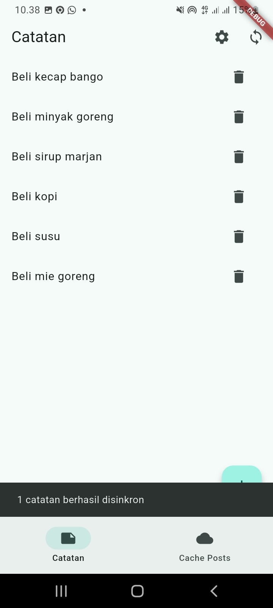 | 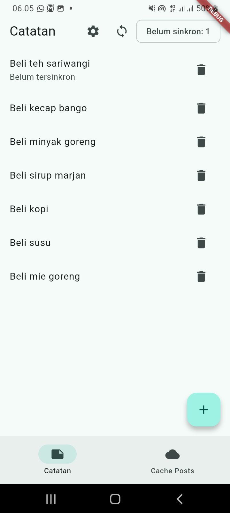 |
| Detail catatan |  | 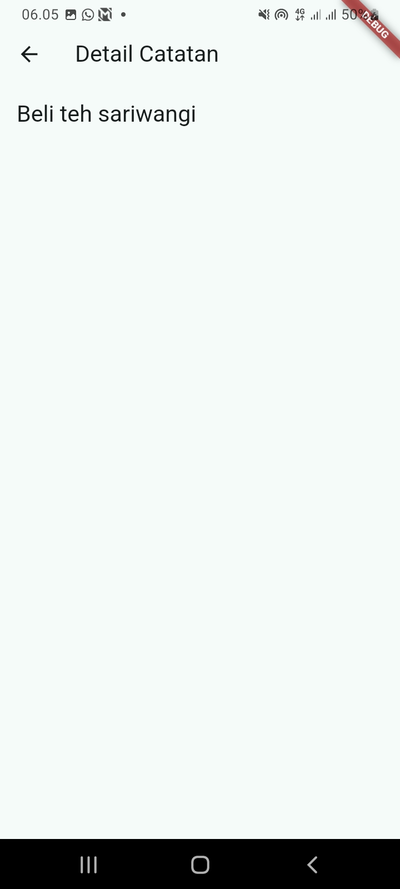 |
| Posts (online) |  |  |
| Posts (offline, dari cache) | 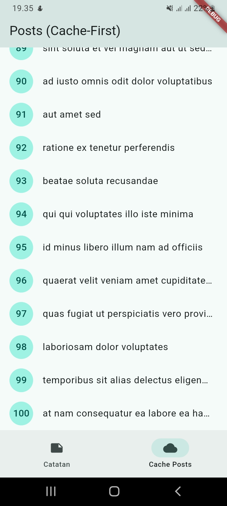 | 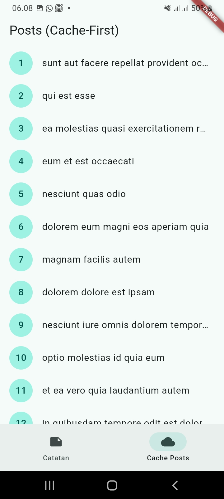 |
| Pengaturan (mode terang) | 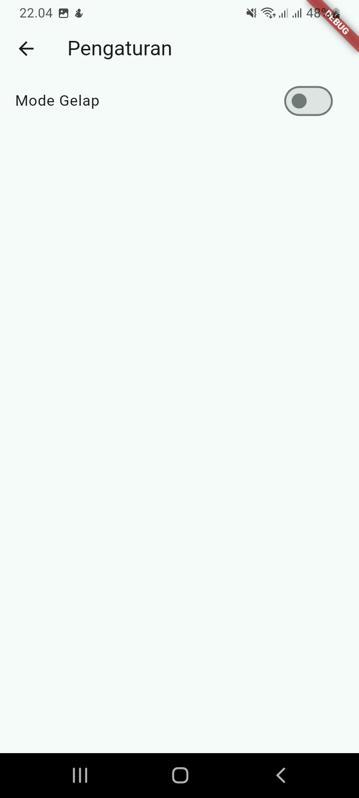 | 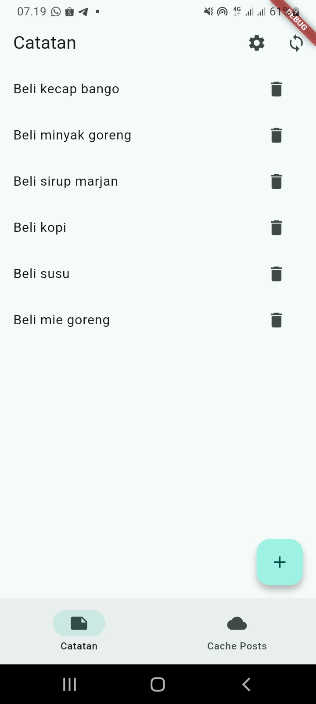 |
| Pengaturan (mode gelap) |  | 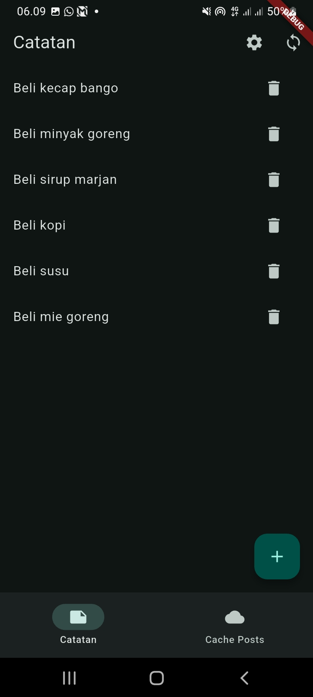 |

#### Analisis

Tampilan sebelum dan sesudah identik, sesuai tujuan refactor. Satu-satunya perubahan perilaku ditemukan saat memindahkan fitur `posts`: pada kode lama, `_refreshInBackground` memanggil `ref.invalidateSelf()`, yang memicu `build()` dan refresh lagi secara berulang selama ada internet. Versi baru mengisi `state` langsung, sehingga refresh hanya terjadi sekali per pembukaan halaman.<Br>

Beberapa trade-off yang disengaja: entity `AppSettings` untuk satu boolean berlebihan secara teknis, tetapi dibuat agar fitur kedua mengikuti pola lengkap sesuai modul; fitur `posts` tidak punya use case karena hanya meneruskan panggilan; dan `PrefsRepository` tidak diubah agar key `dark_mode` tetap sama sehingga preferensi lama tidak hilang. `markOpenedNow` dan `getLastOpened` di `prefs.dart` tidak dipakai di mana pun, tetapi tidak dihapus karena kode mati bawaan itu di luar lingkup tiga poin challenge.

---
### Testing

Tujuh test lulus pada tiga file:

1. **`test/get_notes_test.dart`:** `GetNotes` meneruskan daftar dari repository palsu, dan meneruskan `Failure` tanpa melempar exception. Domain diuji murni, tanpa SQLite maupun Dio.
2. **`test/note_test.dart`:** `fromMap` aman terhadap field yang hilang, flag `dirty` bertahan pada serialisasi, dan provider sukses dengan repository palsu (dari Minggu 5, disesuaikan ke struktur baru).
3. **`test/format_test.dart`:** `parseNoteId` membaca id dari string, dan `tabIndexForLocation` memilih tab yang tepat untuk rute `/posts` dan `/`.

**Hasil:**<br>
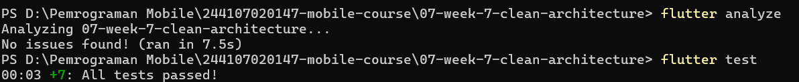

---

### Checklist Verifikasi Mandiri

**1. Tiga grep sterilitas (presentation dan domain) nol hasil.**<br>
Ketiga grep nol hasil setelah refactor, berbeda dari sebelum refactor yang menemukan dua kasus DI bocor.

| Sebelum refactor (2 temuan) | Sesudah: presentation | Sesudah: domain | Sesudah: instansiasi di halaman |
|---|---|---|---|
| 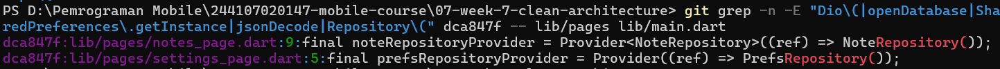 | 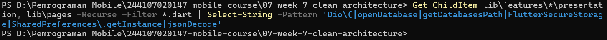 | 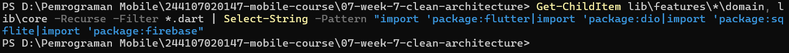 | 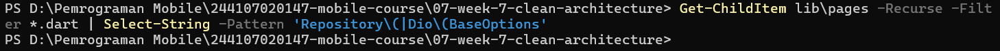 |

**2. Interface di domain, implementasi di data, mapping hanya di model.**<br>
Interface repository ada di `features/*/domain/repositories/`, implementasinya di `features/*/data/repositories/*_impl.dart`. Grep `toMap|fromMap|toJson|fromJson` pada folder `domain` nol hasil; mapping hanya ada di `data/models`.

| Struktur folder | Grep entity bebas mapping |
|---|---|
| 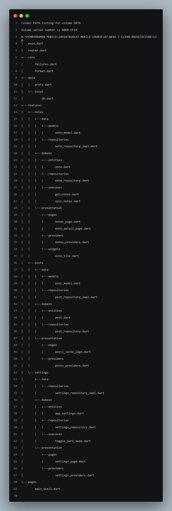 | 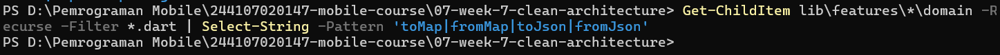 |

**3. Widget tidak menginstansiasi repository; semua lewat provider.**<br>
Grep `Repository\(|RepositoryImpl\(` pada `presentation/pages` dan `presentation/widgets` nol hasil. Pembuatan objek konkret hanya ada di `presentation/providers`.

| Grep halaman dan widget fitur |
|---|
| 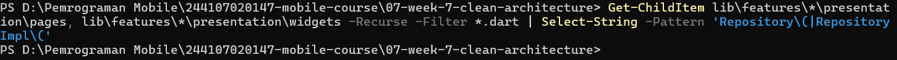 |

**4. Aplikasi berjalan identik sebelum/sesudah refactor (bukti screenshot).**<br>
Lihat tabel before/after di bagian Refactoring Challenge (daftar catatan, detail, posts online dan offline, serta pengaturan mode terang dan gelap).<br>

**5. `flutter analyze` bersih dan semua test lulus.**<br>


---

### Mini Project: Refactor ke Clean Architecture

Seluruh requirement mini project sudah terpenuhi:

1. **Fitur penuh terpisah menjadi domain, data, dan presentation:** `notes`, `posts`, dan `settings` (tiga fitur, melebihi minimal satu).
2. **Dependency rule terbukti:** hasil grep sterilitas ada di bagian Praktikum 3, Checklist poin 1 sampai 3, dan [docs/ai-verification.md](docs/ai-verification.md).
3. **Behavior identik:** screenshot before/after tiap fitur ada di tabel Refactoring Challenge.
4. **Minimal 2 test yang lulus:** tujuh test lulus (use case sukses dan failure dengan repository palsu, mapping model, dan fungsi di `core/format.dart`).
5. **AI Challenge terdokumentasi:** prompt, output AI, tabel usulan-vs-keputusan, dan hasil grep di [docs/ai-verification.md](docs/ai-verification.md).
6. **Struktur folder sesuai portofolio:** `07-week-7-clean-architecture/` berisi `lib/`, `test/`, `docs/`, `screenshots/`, dan `README.md` ini.

#### Hasil yang dicapai

Tiga fitur (`notes`, `posts`, `settings`) kini terpisah menjadi domain, data, dan presentation dengan dependensi satu arah. Perilaku aplikasi tidak berubah (dibuktikan screenshot before/after), `flutter analyze` bersih, dan tujuh test lulus. Satu perbaikan perilaku ditemukan saat refactor: loop refresh tak berujung pada cache posts.

#### Cara Menjalankan

```bash
cd 07-week-7-clean-architecture
flutter pub get
flutter run
```

---

## Refleksi

1. **Mengapa interface repository harus tinggal di domain, bukan di data? Apa yang rusak bila dibalik?**<br>
Jawaban:<br>
Jika interface ada di `data`, domain harus mengimpor data untuk memakai kontraknya, sehingga panah dependensi berbalik dan domain ikut terikat ke sqflite dan Dio. Akibatnya use case tidak bisa diuji tanpa database sungguhan, dan mengganti sumber data berarti mengubah domain. Dengan interface di domain, `data` yang bergantung ke domain, bukan sebaliknya, sehingga use case bisa diuji dengan repository palsu seperti `get_notes_test.dart`.

2. **Kapan use case benar-benar dibutuhkan, dan kapan repository langsung ke notifier sudah cukup?**<br>
Jawaban:<br>
Use case dibutuhkan saat satu operasi menggabungkan beberapa langkah atau punya aturan bisnis, seperti `SyncNotes` (hitung catatan belum sinkron, lalu tandai tersinkron) dan `ToggleDarkMode` (baca, balik nilai, simpan). Untuk CRUD satu baris tanpa aturan, seperti add/delete catatan dan fitur `posts`, notifier langsung ke repository sudah cukup, karena use case hanya akan meneruskan panggilan.

3. **Apa biaya over-engineering (use case per CRUD satu-baris) bagi tim kecil? Kapan biayanya sepadan?**<br>
Jawaban:<br>
Biayanya lebih banyak file dan lebih banyak lompatan baca untuk perubahan kecil. Di project ini, `AppSettings` untuk satu boolean menambah beberapa file tanpa menambah kemampuan. Biaya itu sepadan hanya bila pola yang seragam memang dibutuhkan, misalnya karena modul mewajibkannya atau karena fitur diperkirakan tumbuh dan butuh diuji terpisah.

4. **Bagian mana dari usulan AI yang Anda tolak atau sederhanakan, dan mengapa?**<br>
Jawaban:<br>
Usulan AI menyebut `AppSettings` berlebihan, tetapi tetap dibuat demi pola yang seragam di fitur kedua. Usulan menghapus `markOpenedNow` dan `getLastOpened` tidak diikuti karena di luar lingkup tiga poin challenge, dan dicatat sebagai temuan. Dua hal yang tidak dibahas AI ditemukan sendiri saat memindahkan kode: loop `invalidateSelf()` pada cache posts, dan `main.dart` yang bergantung pada provider yang tertanam di file halaman.

---