# LAPORAN PRAKTIKUM - WEEK 7 PEMROGRAMAN MOBILE

## Identitas Mahasiswa

| Keterangan | Detail |
|---|---|
| Nama | Mufliha Hafsyah Shahieza |
| NIM | 244107020147 |
| Kelas | TI-3G |

---

## JOBSHEET WEEK 7 Clean Architecture

---
### Praktikum 1: Audit layer project lama

#### Tabel Pemetaan

| File | Layer saat ini | Masalah |
|---|---|---|
| `pages/notes_page.dart` | presentation, tercampur | UI (`NotesPage`, baris 36) dan state (`NotesNotifier` baris 13, `noteRepositoryProvider` baris 9, `notesProvider` baris 11, `dirtyCountProvider` baris 31) ada dalam satu file. Repository dibuat langsung `NoteRepository()` (baris 9). Tombol sync memanggil `syncNotes(...)` dari lapisan data di dalam widget (baris 56) |
| `pages/settings_page.dart` | presentation, tercampur | UI (`SettingsPage`, baris 24) dan state (`prefsRepositoryProvider` baris 5, `darkModeProvider` baris 7, `DarkModeNotifier` baris 9) ada dalam satu file. Repository dibuat langsung `PrefsRepository()` (baris 5) |
| `pages/posts_cache_page.dart` | presentation | Mengakses `Map` mentah (`post['id']`, `post['title']`, baris 24 dan 26), belum ada entity |
| `pages/note_detail_page.dart` | presentation | Mengimpor `notes_page.dart` hanya untuk mengakses `notesProvider` (baris 3) |
| `pages/widgets/note_tile.dart` | presentation | Mengimpor `../../data/local/note.dart` (baris 2), sehingga presentation bergantung ke kelas `Note` di lapisan data yang masih gabungan entity dan model |
| `pages/main_shell.dart` | presentation | Hanya navigasi. Tidak ada pelanggaran pada pencarian |
| `router.dart` | presentation (konfigurasi rute) | Setara `routes.dart` pada struktur target modul. Tidak ada pelanggaran pada pencarian |
| `main.dart` | presentation (root aplikasi) | Mengambil `darkModeProvider` dari `pages/settings_page.dart` (import baris 4) |
| `data/sync.dart` | data, tercampur | Provider cache posts (baris 6) dan `syncNotes` (baris 31) dalam satu file. Mengimpor `../pages/notes_page.dart` (baris 2), jadi data bergantung ke presentation |
| `data/repositories/note_repository.dart` | data, kontrak tercampur | `NoteRepository` adalah kelas konkret tanpa interface (baris 7). `Dio(BaseOptions(...))` dibuat di dalam repository (baris 77). Memakai `note.toMap()` (baris 27). Exception belum dibungkus `Failure` |
| `data/local/note.dart` | data dan domain tercampur | `toMap` (baris 16) dan `fromMap` (baris 24) menyatu dengan `Note`, jadi entity dan model belum dipisah |
| `data/local/cached_post.dart` | data, tidak terpakai | `CachedPost` hanya muncul di file definisinya sendiri |
| `data/prefs.dart`, `data/local/db.dart` | data | Tidak ada pelanggaran yang terbukti pada pencarian |

#### Hasil Pencarian Pelanggaran

Perintah `rg` pada modul diganti `Get-ChildItem -Recurse | Select-String` (PowerShell) karena ripgrep tidak terpasang di Windows. 

| Pencarian | Hasil |
|---|---|
| 1. Widget menyentuh jaringan/database langsung | 0 hasil |
| 2. Logika bisnis di dalam `build()` | 0 hasil |
| 3. Instansiasi manual (DI bocor) | 2 hasil |
| 4. Data mengimpor presentation (tambahan, di luar modul) | 1 hasil |

```
lib\pages\notes_page.dart:9:final noteRepositoryProvider = Provider<NoteRepository>((ref) => NoteRepository());
lib\pages\settings_page.dart:5:final prefsRepositoryProvider = Provider((ref) => PrefsRepository());
lib\data\sync.dart:2:import '../pages/notes_page.dart';
```

Setiap temuan menjadi satu item refactor: wiring repository dipusatkan di provider, `sync.dart` tidak lagi mengimpor `pages/`, interface dipisah dari implementasi, entity dipisah dari model, `Dio` disuntikkan ke repository, dan import presentation yang menunjuk ke data atau antarhalaman diperbarui.

#### Struktur Target

```
lib/
├── core/
│   └── failures.dart
├── features/
│   └── notes/
│       ├── domain/
│       │   ├── entities/note.dart
│       │   ├── repositories/note_repository.dart   # interface
│       │   └── usecases/get_notes.dart, add_note.dart
│       ├── data/
│       │   ├── models/note_model.dart
│       │   └── repositories/note_repository_impl.dart
│       └── presentation/
│           ├── providers/notes_providers.dart
│           └── pages/notes_page.dart
├── router.dart
└── main.dart
```

Struktur mengikuti modul untuk fitur `notes`. `router.dart` tetap di `lib/` karena berperan sebagai `routes.dart` pada modul. Penyesuaian untuk operasi tambahan (hapus catatan, sinkronisasi, cache posts) dan fitur kedua `settings` dicatat pada Praktikum 2 dan Refactoring Challenge.

#### Analisis

Widget sudah bersih dari akses jaringan dan database (pencarian 1 dan 2 nol hasil). Pelanggarannya ada di pembuatan repository secara manual di folder presentation dan di arah dependensi yang terbalik: `sync.dart` mengimpor `pages/`, sementara `note_tile.dart` mengimpor `data/`. Targetnya, tiga pencarian modul tetap nol hasil setelah Praktikum 3, dan tidak ada lagi import data ke presentation maupun presentation ke data di luar wiring provider.

---
### Praktikum 2: Domain dan Data Per Fitur

#### File yang Dibuat

```
lib/
├── core/
│   └── failures.dart
└── features/
    └── notes/
        ├── domain/
        │   ├── entities/note.dart
        │   ├── repositories/note_repository.dart   # interface
        │   └── usecases/get_notes.dart, sync_notes.dart
        └── data/
            ├── models/note_model.dart
            └── repositories/note_repository_impl.dart
```

Kode lama (`data/local/note.dart`, `data/repositories/note_repository.dart`, `data/sync.dart`) belum dihapus. Keduanya sementara berdampingan dan baru diganti pada Praktikum 3.

#### Penyesuaian dari Modul

- **Interface repository diperluas.** Modul hanya memuat `fetchNotes` dan `addNote`. Aplikasi ini juga punya hapus catatan, hitung catatan belum sinkron, dan tandai tersinkron. Ketiganya (`deleteNote`, `countDirty`, `markAllSynced`) ditambahkan dengan pola kontrak yang sama agar perilaku tetap identik.
- **Use case `SyncNotes` ditambahkan.** Logika `syncNotes` yang sebelumnya ada di `data/sync.dart` dipindah ke domain. Isinya menggabungkan dua operasi repository dan punya aturan sendiri: berhenti bila tidak ada catatan yang belum sinkron.
- **Use case `AddNote` tidak dibuat.** Struktur pada modul mencantumkan `add_note.dart`, tetapi teks modul menyebut CRUD satu baris cukup lewat repository langsung. Karena itu `addNote` dan `deleteNote` dipanggil langsung dari notifier.
- **Konstruktor `NoteRepositoryImpl`** memakai `this._openDb` mengikuti saran analyzer (`prefer_initializing_formals`), berbeda dari penulisan pada modul.
- **`db.dart` tetap di `lib/data/local/`.**
- **Cache posts belum diubah.** Penanganannya dicatat pada Refactoring Challenge.

#### Hasil Implementasi

`flutter analyze` pada tahap ini: **No issues found!**

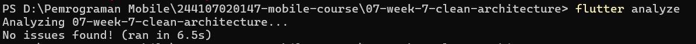

#### Analisis

Entity `Note` kini murni tanpa mapping, sedangkan `toMap` dan `fromMap` hanya ada di `NoteModel` yang mengubah kembali datanya menjadi entity lewat `toEntity()`. Repository mengembalikan record `(data, failure)` sehingga kegagalan SQLite menjadi `LocalFailure` dan tidak bocor sebagai exception ke lapisan di atasnya.<br>

`GetNotes` hanya meneruskan hasil repository. `SyncNotes` dipisah sebagai use case karena menggabungkan beberapa operasi dan punya aturan sendiri, sedangkan tambah dan hapus catatan cukup lewat repository langsung.

---
### Praktikum 3: Presentation, DI, dan Verifikasi

#### Perubahan yang Dilakukan

- **DI terpusat** di `features/notes/presentation/providers/notes_providers.dart`: `noteRepositoryProvider` membuat `NoteRepositoryImpl(openDb: openNotesDb)`, lalu `getNotesProvider` dan `syncNotesProvider` menerima abstraksi `NoteRepository`.
- **Halaman notes dipindah** ke `features/notes/presentation/` (`notes_page.dart`, `note_detail_page.dart`, `widgets/note_tile.dart`). `router.dart` hanya diubah bagian importnya.
- **`sync.dart` tidak lagi mengimpor `pages/`.** Fungsi `syncNotes` digantikan use case `SyncNotes`, dan tombol sync di `NotesPage` memanggil `syncNotesProvider`.
- **Test diadaptasi.** `test/note_test.dart` memakai `NoteModel` dan fake yang mengimplementasikan interface baru. `test/get_notes_test.dart` ditambahkan (use case sukses dan failure).

#### Verifikasi Dependency Rule

Perintah `rg` pada modul diganti `Get-ChildItem -Recurse | Select-String` (PowerShell) dengan pola yang sama.

| Pemeriksaan | Sebelum | Sesudah | Target modul |
|---|---|---|---|
| 1. Presentation steril dari data mentah | 0 hasil | 0 hasil | 0 hasil |
| 2. Domain steril dari framework dan package | belum ada domain | 0 hasil | 0 hasil |
| 3. Repository dibuat manual di `lib/pages` | 2 hasil | 1 hasil | 0 hasil |
| 4. Data mengimpor presentation (tambahan) | 1 hasil | 0 hasil | 0 hasil |

Pemeriksaan 3 masih menyisakan satu hasil, belum mencapai target nol:

```
lib\pages\settings_page.dart:5:final prefsRepositoryProvider = Provider((ref) => PrefsRepository());
```

Repository preferensi masih dibuat langsung di folder `pages`. Ini ditangani pada Refactoring Challenge saat fitur `settings` dipisah ke layer.<br>

`flutter analyze` pada tahap ini: No issues found!, dan`flutter test`: all test passed.<br> 

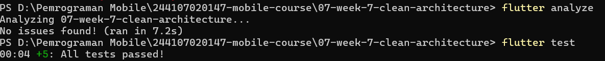

#### Hasil Implementasi

Aplikasi diuji ulang dan tampilannya sama dengan sebelum refactor.

| | Catatan Tersinkron | Badge Belum Sinkron | Cache Posts |
|---|---|---|---|
| Before |  | 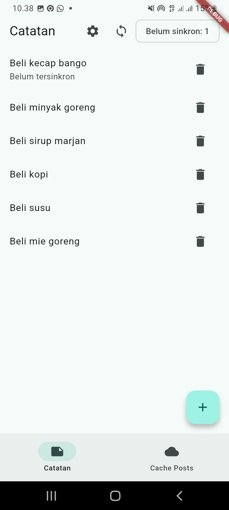 |  |
| After | 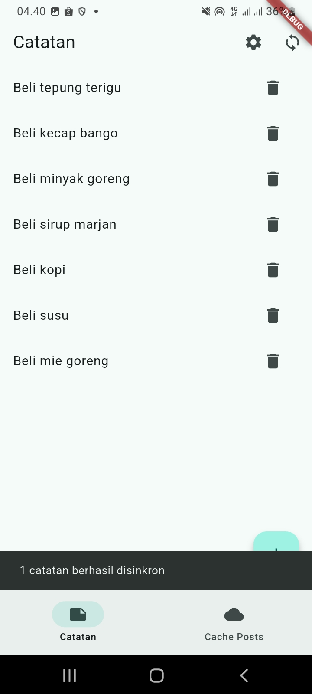 | 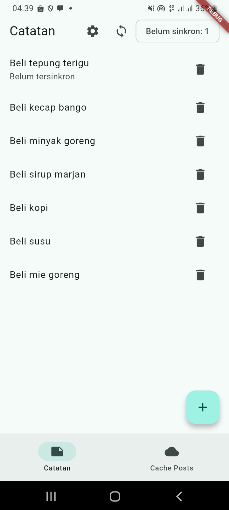 | 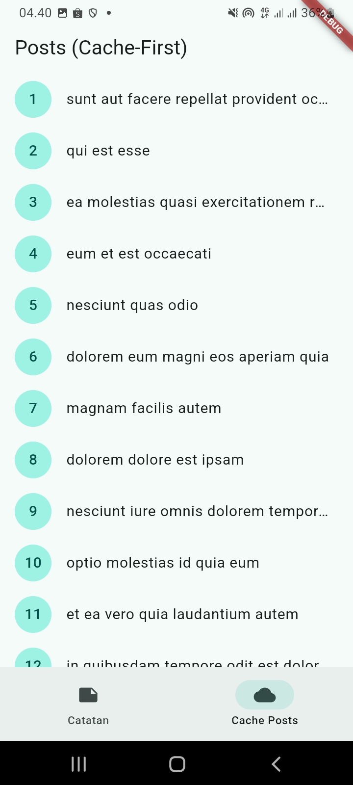 |

| | Hapus Catatan | Detail Catatan | Dark Mode |
|---|---|---|---|
| Before | 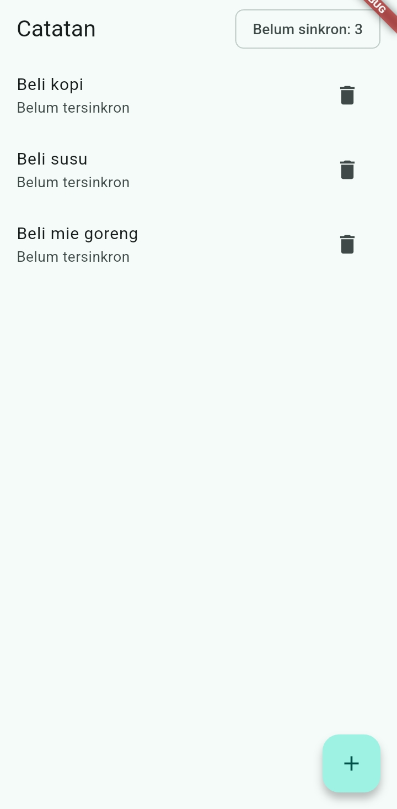 | 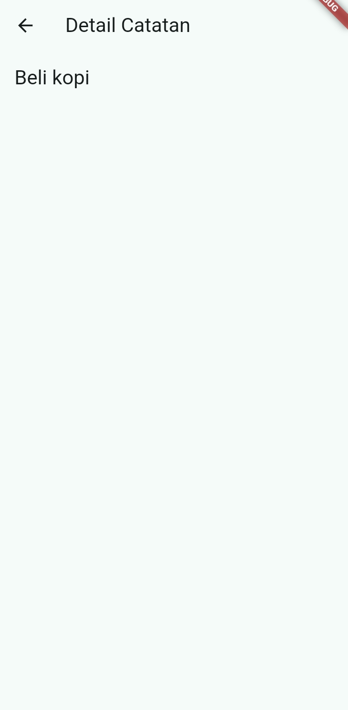 |  |
| After | 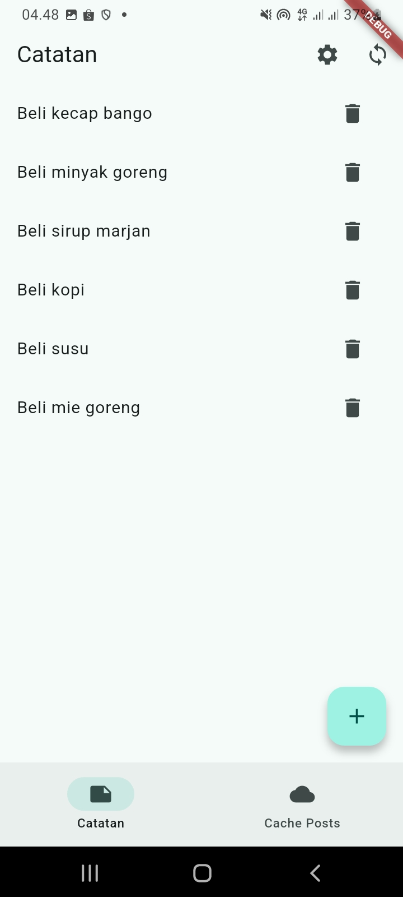 | 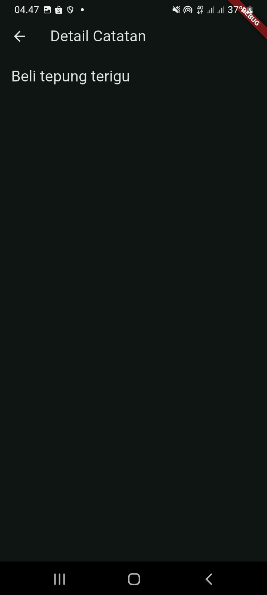 | 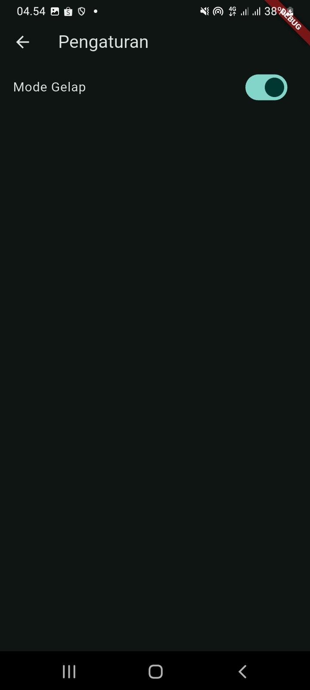 |

#### Analisis

Pelanggaran terbesar sebelum refactor ada pada arah dependensi dan pembuatan repository secara manual, bukan pada widget. Sekarang repository hanya dibuat di satu tempat (`notes_providers.dart`), `sync.dart` tidak lagi bergantung ke presentation, dan domain bebas dari import framework.<br>

Perilaku aplikasi tidak berubah, terlihat dari enam screenshot yang sama persis sebelum dan sesudah refactor (daftar catatan, badge belum sinkron, cache posts, hapus catatan, detail catatan, dan dark mode).

---