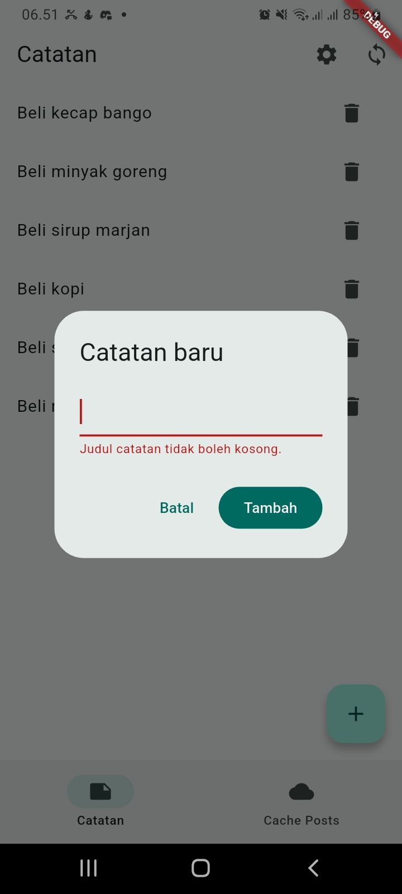
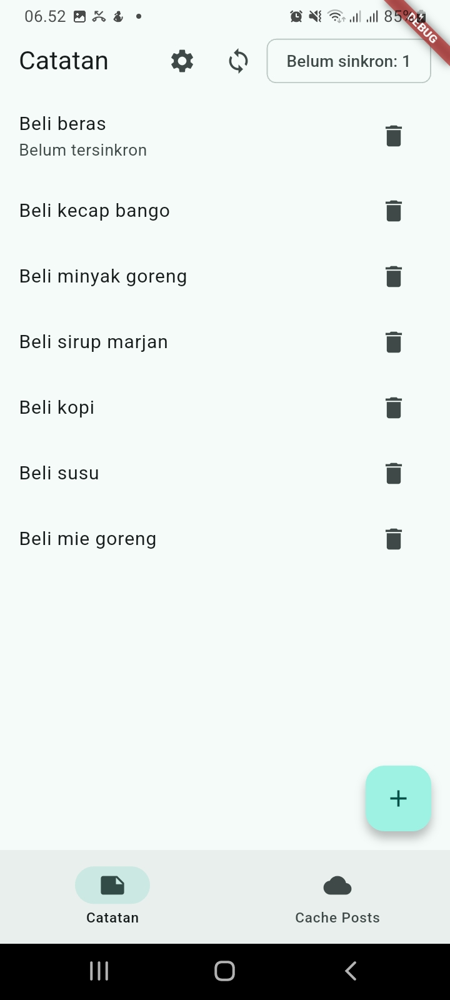
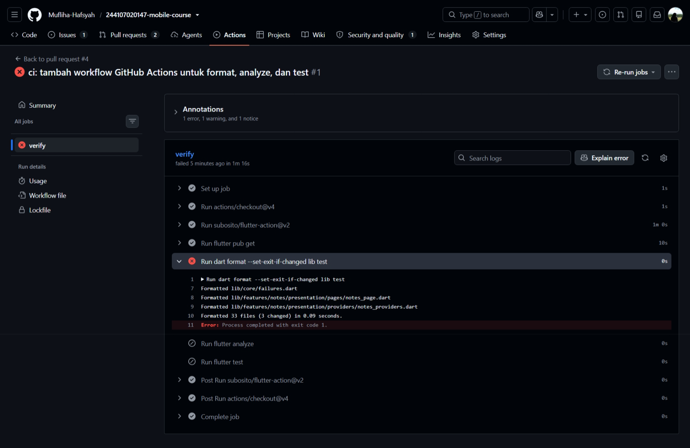
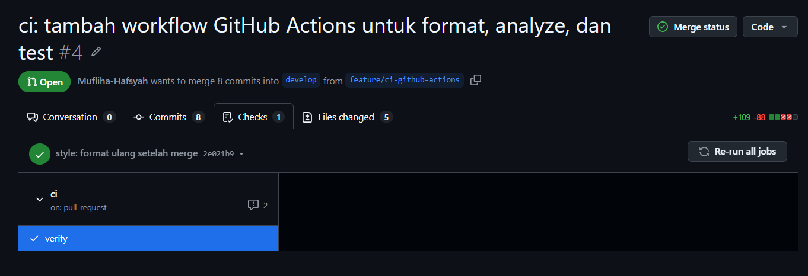
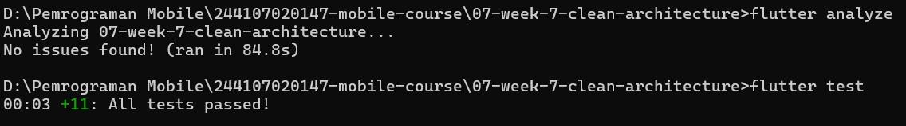

# LAPORAN PRAKTIKUM - WEEK 8 PEMROGRAMAN MOBILE

## Identitas Mahasiswa

| Keterangan | Detail |
|---|---|
| Nama | Mufliha Hafsyah Shahieza |
| NIM | 244107020147 |
| Kelas | TI-3G |

---

## JOBSHEET WEEK 8 Mid Project Review & Code Review

Minggu ini tidak membuat project baru. Yang direview adalah project Week 7 (`07-week-7-clean-architecture`, lanjutan `week5_offline_notes`). Perubahan kodenya tetap berada di folder Week 7 dan masuk lewat Pull Request, sedangkan folder ini hanya berisi dokumentasi proses (`README.md`, `docs/`, `screenshots/`).<br>

**Alur kerja:** issue, branch dari `develop`, commit kecil, Pull Request ke `develop`, review, merge.

| Branch | Peran |
|---|---|
| `main` | Selalu bisa dirilis, tidak dikerjakan langsung |
| `develop` | Integrasi, target default semua PR (juga dijadikan default branch repository) |
| `feature/*` | Kerja satu fitur, pendek |
| `chore/*`, `docs/*` | Perubahan non-fitur (format, dokumentasi) |

---
### Praktikum 1: Audit Riwayat dan Branch Kerja yang Benar

#### Langkah 1: Audit riwayat

Perintah yang dijalankan di repository portfolio: `git log --oneline -15`, `git branch -a`, dan `git status`.

```
f070e81 (HEAD -> main) feat: menyelesaikan Refactoring Challenge Week 7 dan  lengkapi README Week 7 serta tambah screenshot bukti verifikasi
0692143 docs: tambah dokumentasi AI Challenge dan navigasi README
7582e50 refactor: praktikum 3 - DI terpusat, halaman notes ke presentation, verifikasi dependency rule
6a1bb1c refactor: praktikum 2 - domain dan data layer fitur notes
b5625f5 docs: praktikum 1 - pemetaan file ke layer dan pencarian pelanggaran
dca847f chore: snapshot before clean architecture
772e856 docs: memperbaiki format README agar tabel pengujian ketiga app state terbaca
2052ea2 test: menambahkan unit test sesuai pola modul di auth_push_test.dart
8cfa282 docs: memindahkan detail test ke section Testing, meringkas checklist poin 5
6702609 docs: tambahkan bukti uji reinstall/clear data untuk token FCM
0241e7c docs: Menambahkan mini project dan menjawab refleksi di README
bea5cb8 docs: update README to clarify token persistence and logout behavior
c67bc37 docs: menambahkan checklist verifikasi mandiri
8d5d24b test: unit test routeFromMessage dan TokenStore dengan fake secure storage
5f2b5e4 refactor: konstanta rute dan pindahkan mapping error Dio
```

`git branch -a` hanya menampilkan `main` dan `remotes/origin/main`. `git status` bersih (`nothing to commit, working tree clean`), tetapi branch lokal tertinggal 4 commit dari `origin/main`.

| Temuan | Bukti | Tindak lanjut |
|---|---|---|
| Commit langsung ke `main` | Seluruh commit Week 7 ada di `main`, tidak ada branch lain | Dibuat `develop`; pekerjaan Week 8 memakai branch terpisah dan masuk lewat PR |
| Satu commit memuat banyak perubahan | `f070e81` memuat refactoring, README, dan screenshot sekaligus | Dipisah per perubahan logis dengan `git add` per file |
| Pesan commit tidak konsisten | `docs: update README to clarify token persistence...` tanpa scope dan berbeda bahasa dengan commit lain | Memakai format `tipe(scope): deskripsi` |
| Pesan commit kurang informatif | `dca847f chore: snapshot before clean architecture` | Pesan menjelaskan apa dan di mana yang berubah |
| Branch lokal tertinggal dari remote | `Your branch is behind 'origin/main' by 4 commits` | `git pull` (fast-forward) sebelum membuat branch |
| File tak terlacak | Tidak ada | Tidak ada tindakan |

#### Langkah 2: Branch kerja

Branch `develop` belum ada, jadi dibuat sekali dari `main` (sesuai catatan jobsheet), lalu di-push.

```
git fetch origin
git pull
git checkout -b develop
git push -u origin develop
```

Branch fitur dibuat dari `develop`:

```
git checkout -b feature/notes-validation
```

Bukti: `develop` ada di remote dan branch lokal `feature/notes-validation` melacak `origin/feature/notes-validation`.

#### Langkah 3: Perbaikan pesan commit

| Sebelum | Sesudah | Alasan |
|---|---|---|
| `feat: menyelesaikan Refactoring Challenge Week 7 dan  lengkapi README Week 7 serta tambah screenshot bukti verifikasi` | `refactor(notes): selesaikan refactoring challenge clean architecture` | Satu tujuan dan scope jelas. README dan screenshot dipisah ke commit `docs(week7): ...` |
| `chore: snapshot before clean architecture` | `chore(notes): simpan kondisi awal sebelum refactor clean architecture` | Menjelaskan apa yang disimpan dan tujuannya, sehingga mudah dilacak dan di-revert |
| `docs: update README to clarify token persistence and logout behavior` | `docs(auth): jelaskan persistensi token FCM dan perilaku logout` | Menambah scope `auth` dan konsisten berbahasa Indonesia |

Tabel lengkap beserta riwayat kerja Week 8 ada di [docs/review-checklist.md](docs/review-checklist.md).

---
### Praktikum 2: Code Review & Penanganan Temuan

Proses review dilakukan melalui Pull Request ke branch `develop`. Terdapat dua PR utama yang merepresentasikan alur kerja ini.

#### 1. PR #2: Validasi Judul Kosong (Fitur)
Reviewer (`febrianucup`) memberikan beberapa temuan kritis terkait arsitektur dan penanganan *error*. Berikut adalah rangkuman temuan dan perbaikannya:

| Temuan Reviewer | Dampak | Solusi yang Diterapkan |
|---|---|---|
| **Kebenaran:** Hanya `ValidationFailure` yang ditangani. Failure lain (seperti `LocalFailure`) lolos dan membuat dialog tertutup tanpa pesan. | Pengguna tidak tahu jika penyimpanan gagal dan teks yang diketik hilang. | Mengubah logika UI. Semua *failure* kini dikembalikan sebagai `String?` dari `addNote`. Jika ada error, dialog tetap terbuka dan pesan ditampilkan. |
| **Arsitektur:** Error dilaporkan lewat dua jalur (return value untuk validasi, state untuk error lain). | Kontrak kode tidak jelas dan UI terpaksa mengecek tipe *failure*. | Menyeragamkan kontrak: `Future<String?> addNote(String title)`. State `AsyncError` dihapus dari alur penambahan catatan. |
| **Test:** Hanya *use case* yang diuji. `NotesNotifier` dan dialog tidak punya test. | Bug penanganan error dan *race condition* pada dialog lolos tanpa terdeteksi. | Menambahkan *Unit Test* untuk `NotesNotifier` dan *Widget Test* untuk memastikan dialog tetap terbuka saat validasi gagal. Whitespace (`\t`, `\n`) juga diparameterkan. |

**Bukti Perbaikan:**
1. Validasi judul kosong berhasil menampilkan error tanpa menutup dialog:
   
2. Catatan berhasil ditambahkan saat judul diisi dengan benar:
   

---
### Praktikum 3: CI/CD & Otomasi Pengujian

Untuk mencegah kode yang "kotor" masuk ke branch `develop`, dibuatlah *workflow* otomatis (CI) menggunakan GitHub Actions. Ini merupakan implementasi dari PR #4.

- **Masalah:** Sebelumnya, proses *format*, *analyze*, dan *test* hanya dijalankan manual di lokal.
- **Solusi:** Membuat file `.github/workflows/ci.yml` yang otomatis berjalan setiap kali ada *Pull Request* ke `develop`.
- **Kendala & Penyelesaian:** CI sempat berstatus merah (*failed*) karena masalah *path directory* dan format kode yang belum rapi setelah proses *merge*. Hal ini diselesaikan dengan menambahkan konfigurasi `working-directory: ./07-week-7-clean-architecture` dan menjalankan `dart format lib test` sebelum melakukan *push* ulang.

**Bukti CI Gagal karena Format:**<br>
<br>

Setelah semua temuan diperbaiki, melakukan format ulang, dan seluruh *test* berstatus *passed*, CI berubah menjadi **hijau (All checks have passed)**. PR kemudian di-*merge* dan branch fitur dihapus.

<br>

**Bukti Analyze dan Test Hijau:**<Br>


---
### AI Prompt Challenge

Dokumentasi lengkap (prompt, output awal AI, verifikasi dengan checklist, hasil grep dependency rule, dan perbandingan usulan AI dengan keputusan akhir) ada di:

[docs/ai-review-vs-keputusan.md](docs/ai-review-vs-keputusan.md)

---
### Refactoring Challenge (Lanjutan Week 7)
Tiga poin dikerjakan, dengan satu penyimpangan yang dicatat:

1. **Fitur kedua `settings` (dan pembersihan cache `posts`).** Jobsheet menyebut `auth`/`announcements`, tetapi project Minggu 5 tidak memilikinya, sehingga fitur kedua adalah `settings` (entity, repository interface + impl, use case `ToggleDarkMode`, provider, halaman). Cache `posts` ikut dipindahkan karena modul berpesan tidak boleh ada satu fitur bersih dan sisanya kotor. File lama dihapus.
2. **`lib/core/format.dart`:** `parseNoteId` (dari `router.dart`) dan `tabIndexForLocation` (dari `main_shell.dart`), diuji tanpa widget di `test/format_test.dart`. **Penyimpangan:** modul menyebut "formatting tanggal dan parsing rute", tetapi project tidak punya formatting tanggal di UI. Membuatnya berarti menambah fitur, yang dilarang modul, sehingga hanya parsing rute yang diekstrak.
3. **Exception mentah menjadi `Failure` ramah pengguna.** Pesan seperti `'Gagal membaca catatan: $e'` kini `'Gagal membaca catatan. Coba lagi.'` dengan penyebab asli di `cause`.

---
### Testing

Dengan ditambahkannya test pada Praktikum 2 minggu ini, total test yang lulus bertambah menjadi **12 test** pada 5 file:

1. **`test/get_notes_test.dart`:** `GetNotes` meneruskan daftar dari repository palsu, dan meneruskan `Failure` tanpa melempar exception.
2. **`test/note_test.dart`:** `fromMap` aman terhadap field yang hilang, dan flag `dirty` bertahan pada serialisasi.
3. **`test/format_test.dart`:** `parseNoteId` membaca id dari string, dan `tabIndexForLocation` memilih tab yang tepat.
4. **`test/add_note_test.dart` (Baru):** Memastikan validasi judul kosong dan whitespace (`\t`, `\n`) menghasilkan `ValidationFailure` dengan pesan yang tepat.
5. **`test/notes_notifier_test.dart` (Baru):** *Unit test* memastikan `addNote` mengembalikan pesan error tanpa mengubah state daftar. *Widget test* memastikan dialog tetap terbuka dan menampilkan pesan error saat judul kosong.

**Hasil:**<br>


---
### Mini Project: Refactor ke Clean Architecture (Mid Project Review)

Seluruh requirement mini project pada paruh semester ini sudah terpenuhi dan dilengkapi dengan standar profesional (Code Review & CI):

1. **Fitur penuh terpisah menjadi domain, data, dan presentation:** `notes`, `posts`, dan `settings`.
2. **Dependency rule terbukti:** hasil grep sterilitas ada di bagian Praktikum 3 (Week 7), dan [docs/ai-review-vs-keputusan.md](docs/ai-review-vs-keputusan.md).
3. **Behavior identik:** perilaku aplikasi tidak berubah setelah refactor (bukti screenshot *before/after* lengkap ada di laporan Week 7).
4. **Minimal 2 test yang lulus:** 12 test lulus (use case, notifier, widget, mapping model, dan fungsi utilitas).
5. **AI Challenge terdokumentasi:** prompt, output AI, tabel usulan-vs-keputusan, dan hasil grep ada di [docs/ai-review-vs-keputusan.md](docs/ai-review-vs-keputusan.md).
6. **Struktur folder sesuai portofolio:** `07-week-7-clean-architecture/` berisi `lib/`, `test/`, `docs/`, `screenshots/`, dan `README.md`.
7. **Standar CI/CD (Baru):** *Workflow* GitHub Actions berjalan otomatis untuk memverifikasi format, analyze, dan test pada setiap Pull Request.
8. **Review Sejawat (Baru):** Fitur validasi judul telah melalui proses *Code Review* (PR #2), menerima masukan terkait arsitektur dan testing, lalu diperbaiki hingga mendapat status *Approve*.

---

## Refleksi

1. **Apa beda LGTM buta dengan approve yang bertanggung jawab? Apa risikonya bagi tim?**<br>
Jawaban:<br>
LGTM (Looks Good To Me) buta adalah persetujuan tanpa membaca kode atau menguji perubahannya, biasanya hanya karena ingin PR cepat selesai. *Approve* yang bertanggung jawab berarti reviewer memeriksa kesesuaian dengan arsitektur, mencari *edge case*, dan memastikan CI berjalan hijau. Risikonya bagi tim sangat fatal: *bug* akan lolos ke *branch* `develop` (seperti penanganan error yang tidak teruji), utang teknis menumpuk, dan standar kode tim lama-kelamaan akan turun karena tidak ada yang mengawasi.

2. **Kapan komentar wajib berstatus request changes, dan kapan cukup saran?**<br>
Jawaban:<br>
*Request changes* wajib digunakan jika temuan tersebut bersifat *blocker* atau melanggar prinsip utama. Contohnya pada PR #2, reviewer memberi status *request changes* karena ada *bug* logika penanganan *failure* (dialog tertutup dan data pengguna hilang) serta pelanggaran arsitektur (error dilaporkan lewat dua jalur berbeda). Ini harus diperbaiki sebelum masuk `develop`. Sebaliknya, saran (comment biasa) cukup digunakan untuk hal yang bersifat *nice-to-have*, seperti usulan penambahan *dispose* pada controller atau optimalisasi performa yang dampaknya kecil dan bisa dikerjakan di PR terpisah.

3. **Bagian mana dari review AI yang Anda tolak atau sederhanakan, dan mengapa?**<br>
Jawaban:<br>
Saya menolak dan menunda saran AI untuk menambahkan *widget test* pada PR #2 (poin 5) dan penambahan *dispose controller* (poin 3) saat itu. Alasannya, menambahkan *widget test* membutuhkan *setup* provider *override* yang cukup besar dan akan membuat PR membengkak melewati batas 300 baris. Saya juga menunda saran *disable button* saat *await* (poin 2) karena dampaknya kecil untuk aplikasi catatan lokal dan belum berhasil direproduksi. Saran-saran ini dicatat di [docs/ai-review-vs-keputusan.md](docs/ai-review-vs-keputusan.md) sebagai temuan yang ditunda dengan alasan teknis, bukan diabaikan begitu saja. (Catatan: *Widget test* akhirnya tetap saya tambahkan setelah diminta oleh reviewer manusia).

4. **Satu hal konkret yang Anda perbaiki setelah review sejawat — apa dampaknya?**<br>
Jawaban:<br>
Hal paling konkret adalah mengubah kontrak `addNote` di `NotesNotifier`. Sebelumnya, method ini mengembalikan `Failure?` dan mengubah *state* daftar menjadi `AsyncError` jika gagal. Setelah review, saya mengubahnya menjadi `Future<String?>` yang hanya mengembalikan pesan *error* (atau `null` jika sukses) tanpa menyentuh *state* daftar. Dampaknya sangat terasa: 
   - UI menjadi jauh lebih bersih karena tidak perlu lagi mengecek tipe *failure* (`if failure is ValidationFailure`). 
   - Dialog tidak akan pernah tertutup secara tidak sengaja saat penyimpanan gagal (`LocalFailure`), sehingga pengguna bisa memperbaiki *error* tanpa kehilangan teks yang sudah diketik.
   - Daftar catatan yang sudah ada tidak ikut menampilkan layar *error* hanya karena satu penambahan catatan gagal.

---

### Cara Menjalankan

```bash
cd 07-week-7-clean-architecture
flutter pub get
flutter run
```
---