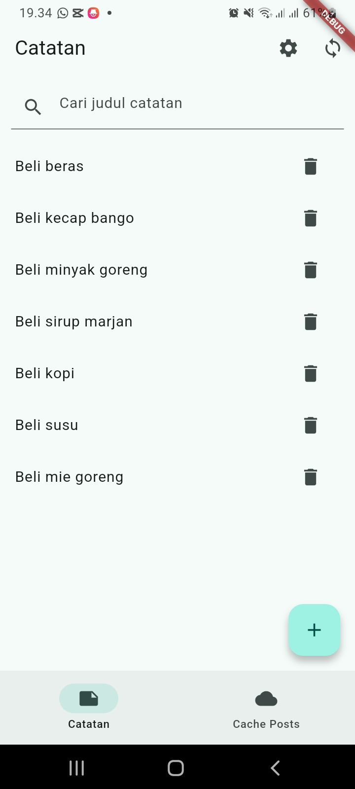
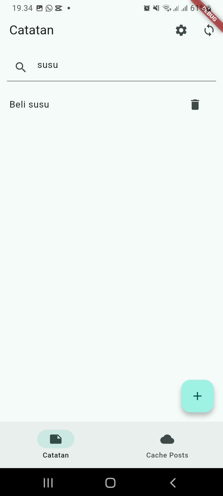
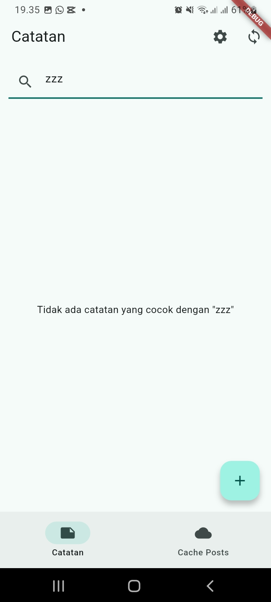
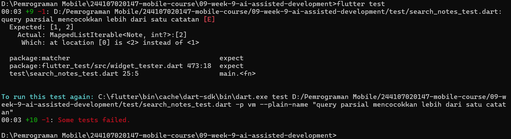
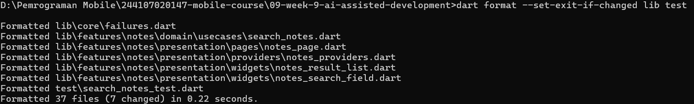
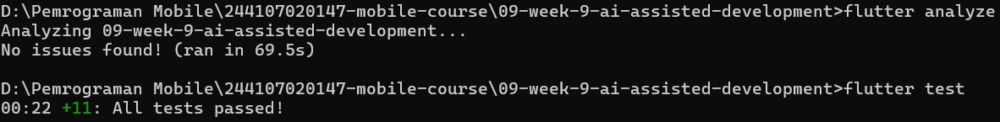

# LAPORAN PRAKTIKUM - WEEK 9 AI-ASSISTED DEVELOPMENT

## Identitas Mahasiswa

| Keterangan | Detail |
|---|---|
| Nama | Mufliha Hafsyah Shahieza |
| NIM | 244107020147 |
| Kelas | TI-3G |

---

## Deskripsi Project
Project ini adalah lanjutan dari Week 7 (Clean Architecture). Pada Week 9, kita menerapkan metode *AI-Assisted Development* (Vibe Coding) untuk menambahkan satu fitur kecil: **Pencarian Judul Catatan (Search Notes)** beserta *empty state*-nya. 
Fitur ini dipilih karena mencakup perubahan dari layer Presentation (UI & Provider) hingga layer Domain (Use Case murni), namun tetap menjaga aturan dependensi (Dependency Rule) tanpa menyentuh layer Data (SQLite/Dio). 

**Stack:** Flutter, Riverpod, GoRouter.

---
### Praktikum 1: Prompt dan Context Engineering

Sebelum menyuruh AI menulis kode, kita merumuskan prompt menggunakan **Formula 5 Slot**:
1. **Peran:** senior Flutter dev.
2. **Konteks:** project Flutter feature-first Clean Architecture, Riverpod, SQLite + Dio.
3. **Tugas:** tambah pencarian judul catatan + *empty state*.
4. **Batas:** jangan ubah arsitektur, jangan panggil SQLite dari widget, logika filter wajib di use case domain murni.
5. **Output:** kode lengkap + unit test + cara uji manual.
 

**Penerapan Konteks dan Privasi:** 
Sesuai arahan jobsheet, prompt tidak dibuat kabur (seperti *"buatkan search yang keren"*). Kita menyertakan konteks berupa potongan kode *entity* `Note` dan menyebutkan struktur folder. Namun, kita **TIDAK** menyertakan token API, password, atau meng-*copy-paste* seluruh isi repository demi menjaga privasi dan keamanan. 

Prompt lengkap dan output awal dari AI didokumentasikan secara transparan di:
[docs/ai-log.md](docs/ai-log.md)

---
### Praktikum 2: Generate dan Verifikasi Search

AI diminta membuatkan satu fitur kecil secara spesifik: use case `SearchNotes`, provider baru (`notesQueryProvider`, `filteredNotesProvider`), serta dua widget (`NotesSearchField` dan `NotesResultList`). Prompt mentah dan output awal AI telah disimpan di [docs/ai-log.md](docs/ai-log.md). 

**Verifikasi 6 Langkah:**
1. **Baca:** Semua kode dibaca dan dipahami alurnya (tidak asal *copy-paste*).
2. **Cek Import:** File `search_notes.dart` di layer domain terbukti murni, bebas dari import Flutter, Dio, maupun SQLite.
3. **Cek API:** Sintaks Riverpod (`NotifierProvider`, `AsyncValue.whenData`) divalidasi kecocokannya dengan versi di `pubspec.lock`.
4. **Analyze:** `flutter analyze` berjalan bersih tanpa *warning*.
5. **Test:** Unit test untuk logika filter dibuat di `test/search_notes_test.dart` (mencakup skenario sukses dan gagal).
6. **Uji Manual:** Dilakukan pengujian ketik langsung di aplikasi. Berikut adalah bukti visual untuk 3 kondisi:

| Daftar Normal (Query Kosong) | Sedang Mencari (Query Cocok) | Empty State (Query Tidak Cocok) |
|---|---|---|
|  |  |  |

 

**Bukti Wajib (Bug/Halusinasi AI):** 
Sesuai ketentuan jobsheet, kami menemukan halusinasi AI saat pembuatan *unit test*. AI menganggap query parsial 'a' akan cocok dengan catatan 'Ide Proyek', padahal kata tersebut tidak mengandung huruf 'a'.  

Hal ini dibuktikan lewat *test* yang gagal (merah) dengan detail error sebagai berikut: 

---
### Praktikum 3: Debug dan Refactor

**1. Debug dengan Test Merah:** 
Kami menerapkan alur *debugging* tanpa mengulang prompt secara buta:
- **Reproduksi:** Menemukan error `Expected: [1, 2] Actual: [2]` saat menjalankan *unit test* pencarian.
- **Isolasi:** Memastikan logika filter sudah berada di *use case* murni (`SearchNotes`), bukan di dalam widget.
- **Test Merah:** *Test* gagal (merah) tersebut menjadi bukti otentik bahwa AI berhalusinasi dalam menebak isi data *dummy*.
- **Perbaiki:** Mengembalikan parameter `id` yang terhapus dan memperbaiki logika *dummy data* pada file `test/search_notes_test.dart`.
- **Catat:** Akar masalah dan bukti *test* merah telah dicatat di `docs/ai-log.md` dan bagian Refleksi.  

**2. Refactor ke Layer yang Benar:** 
Kode hasil AI dipastikan mengikuti alur dependensi satu arah:
`Widget (UI)` -> `Notifier (State)` -> `Use Case (Aturan Filter)` -> `Repository (SQLite/Dio)`.
- Tidak ada panggilan database langsung dari widget.
- Logika filter pencarian dipisahkan sepenuhnya ke dalam *use case* `SearchNotes` (domain) agar UI tetap bersih.  

**3. Verifikasi Akhir:** 
Seluruh kode telah dirapikan menggunakan perintah `dart format --set-exit-if-changed lib test`. Hasilnya, 7 file berhasil diformat ulang agar sesuai standar. 
 

Setelah itu, kode dipastikan kembali lulus uji kebersihan (`flutter analyze`) dan `flutter test` (+11 passed).

---
### AI Challenge: Review Kode oleh AI (Senior Dev)

Sesuai instruksi jobsheet, kita meminta AI untuk mereview hasil kodenya sendiri dengan prompt berikut:
> *"Review kode search Flutter ini sebagai senior dev. Konteks: feature-first (presentation->domain<-data), Riverpod, SQLite + Dio. Fokus: kebenaran, arsitektur, test. Abaikan style. Beri 3 temuan + level blocker/saran + alasan."*

Dari 3 temuan yang diberikan AI, keputusan diambil sebagai berikut:

| Temuan / Saran AI | Keputusan | Alasan Teknis |
|---|---|---|
| **[BLOCKER]** Gunakan `TextEditingController` lokal pada `NotesSearchField` alih-alih langsung `ref.read` di `onChanged`. | **Tolak** | Menambah *boilerplate* (lifecycle dispose). Untuk fitur filter *real-time*, pemanggilan state langsung via `onChanged` sudah cukup dan efisien. |
| **[SARAN]** Error handling di `NotesResultList` masih statis `'Terjadi kesalahan'`, seharusnya pakai `messageFromError`. | **Terima** | Selaras dengan arsitektur Week 7. Error handling harus mem-parsing `Failure` agar pesan yang tampil ke pengguna informatif. |
| **[SARAN]** `SearchNotes` hanya mencari di `title`, sebaiknya cari juga di `body` (isi catatan). | **Tolak** | *Out of scope*. Prompt dan ketentuan jobsheet secara eksplisit hanya meminta pencarian judul. |

*(Prompt dan konteks lengkap terkait review ini terdokumentasi di `docs/ai-log.md`)*

---
### Testing

Kita telah membuat 4 skenario pengujian pada `test/search_notes_test.dart` (menguji use case murni):
1. Query kosong mengembalikan semua catatan.
2. Query mencocokkan judul tanpa peduli huruf besar/kecil.
3. Query parsial mencocokkan lebih dari satu catatan.
4. Query tanpa hasil mengembalikan list kosong.

**Hasil:** 

---
### Checklist Verifikasi Mandiri

**1. Prompt 5 slot + konteks terdokumentasi di `docs/ai-log.md`.** 
Prompt lengkap dengan pembatasan arsitektur, potongan kode entity, dan output awal AI sudah tersimpan di log.  

**2. `flutter analyze` bersih, `flutter test` hijau.** 
Semua kode berjalan tanpa *warning* dan 11 test (7 dari Week 7 + 4 test baru) lulus.
  

**3. Logika filter berada di domain (Use Case), bukan di widget.** 
Logika `SearchNotes` murni berada di `lib/features/notes/domain/usecases/search_notes.dart` tanpa import Flutter atau SQLite.  

**4. Aplikasi berjalan sesuai harapan (bukti screenshot).** 
Lihat tabel bukti visual Uji Manual di bagian Praktikum 2 (Daftar Normal, Sedang Mencari, dan Empty State).  

**5. Satu temuan AI diadopsi dan satu temuan ditolak (dengan alasan).** 
Temuan terkait `messageFromError` diterima, temuan penggunaan `TextEditingController` dan pencarian di `body` ditolak. Detail ada di tabel AI Challenge.

---
## Mini Project / Industry Challenge

1. **Fitur Kecil:** Fitur pencarian judul (`SearchNotes`) dan *empty state* berhasil ditambahkan.
2. **AI Log:** Prompt, konteks, dan output awal AI tersimpan di `docs/ai-log.md`.
3. **Bukti Hijau:** `flutter analyze` (No issues found) dan `flutter test` (+11 tests passed).
4. **Tabel Terima/Tolak:** Terdokumentasi di atas beserta alasan teknisnya.
5. **Push Repo:** Folder `09-week-9-ai-assisted-development/` berisi `docs/`, `lib/`, `test/`, dan `README.md`.

---
## Refleksi

1. **Satu halusinasi AI apa yang Anda temukan dan bagaimana membuktikannya?** 
Jawaban: 
Saat membuat unit test, AI berhalusinasi dalam menentukan ekspektasi logika pencarian. AI menganggap query parsial 'a' akan cocok dengan catatan 'Ide Proyek', padahal kata tersebut tidak mengandung huruf 'a'. Hal ini terbukti saat saya menjalankan `flutter test` dan muncul error merah `Expected: [1, 2] Actual: [2]`. Saya membuktikannya dengan mengecek ulang teks pada masing-masing catatan di data dummy. 

2. **Prompt mana yang paling membantu dan apa yang Anda ubah?** 
Jawaban: 
Prompt yang paling membantu adalah bagian **Batas** (constraints), di mana saya melarang AI menyentuh layer *data* dan memaksa logika filter diletakkan di *use case* domain yang murni (`SearchNotes`). Ini membuat output AI langsung bersih dari *dependency* SQLite. Yang saya ubah adalah instruksi **Output**: AI awalnya hanya disuruh membuat kode, tapi saya minta tambahan agar ia membuatkan *unit test* terpisah dan panduan uji manual agar hasilnya lebih terverifikasi.

3. **Satu refactor apa yang Anda lakukan pada kode AI?** 
Jawaban: 
Saya merefactor `notes_page.dart` agar memanggil widget `NotesResultList`. AI awalnya hanya menyarankan untuk menaruh kotak pencarian di atas `ListView` yang sudah ada. Namun, agar *error handling* dan *empty state* (pesan saat pencarian tidak cocok) tertangani dengan baik tanpa mengotori halaman utama, saya memisahkan logika daftar tersebut ke dalam `NotesResultList` yang memantau `filteredNotesProvider`.