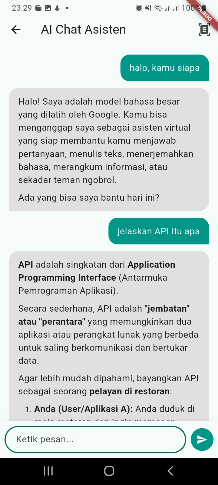
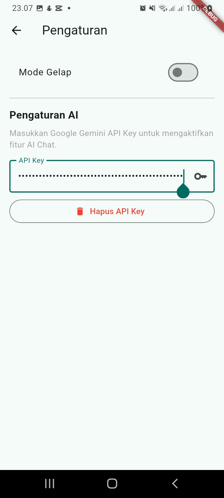
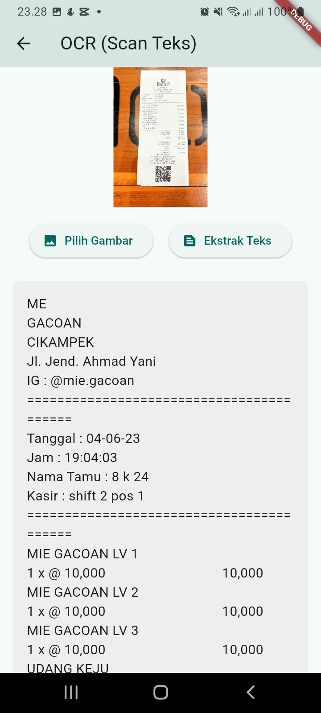
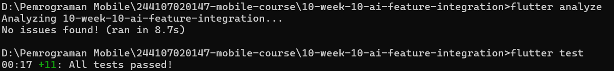

# LAPORAN PRAKTIKUM - WEEK 10 INTEGRASI FITUR AI

## Identitas Mahasiswa

| Keterangan | Detail |
|---|---|
| Nama | Mufliha Hafsyah Shahieza |
| NIM | 244107020147 |
| Kelas | TI-3G |

---

## Deskripsi Project
Project ini adalah kelanjutan dari Week 9. Pada Week 10, kita mengintegrasikan fitur AI berupa **AI Chat Assistant** menggunakan Google Gemini API. Fitur ini memungkinkan pengguna bertanya langsung kepada AI dan mendapatkan jawaban *real-time* di dalam aplikasi. 

**Stack:** Flutter, Riverpod, GoRouter, `http`, `flutter_secure_storage`, `flutter_markdown`.

---

### Praktikum: Chat Interface dengan AI

Sesuai dengan jobsheet, kita mengimplementasikan fitur **Chat Interface** menggunakan LLM API (Google Gemini). 
- **AI Service:** Dibuat di `lib/ai/ai_service.dart` menggunakan package `http`. Kunci API **tidak pernah disimpan langsung di kode sumber**, melainkan disimpan secara aman menggunakan **`flutter_secure_storage`**.
- **UI Chat:** Dibuat dengan desain gelembung chat (bubble). Menggunakan `flutter_markdown` agar jawaban AI (seperti *list* atau teks tebal) dirender dengan rapi, bukan sebagai teks mentah.
- **UX:** Saat AI sedang memproses jawaban, muncul animasi *typing indicator* (3 titik bergerak) agar aplikasi terasa responsif.

**Bukti UI:**
| Halaman Chat AI | Halaman Pengaturan API Key |
|---|---|
|  |  |

---

### OCR, Speech-to-Text, dan Image Understanding

Dari tiga fitur yang ditawarkan pada jobsheet, saya memilih untuk mengimplementasikan **dua** fitur sekaligus:
1. **Chat Interface:** Menggunakan model LLM untuk menjawab pertanyaan pengguna.
2. **OCR (Optical Character Recognition):** Mengekstraksi teks dari gambar (seperti struk atau dokumen) menggunakan model Gemini Multimodal. 

Fitur Speech-to-Text dan Image Understanding tidak diimplementasikan agar fokus pengembangan tidak terpecah dan kualitas dua fitur utama tetap maksimal.  

**Implementasi OCR:** 
- Pengguna dapat memilih gambar dari galeri menggunakan `image_picker`.
- Gambar dikonversi menjadi *Base64* dan dikirim ke API Gemini melalui `ai_service.dart`.
- AI mengekstrak teks dan menampilkannya di layar.   

**Bukti UI OCR:** 

---

### Privasi, Biaya, Error Handling, dan Fallback

Berikut adalah tabel risiko dan mitigasi yang diterapkan pada fitur AI ini:

| Risiko | Mitigasi |
|---|---|
| **Bocor data pengguna** | API Key disimpan secara lokal dan terenkripsi menggunakan `flutter_secure_storage`. Tidak ada token/kunci yang di-*hardcode* di kode sumber. |
| **Biaya melonjak** | Menggunakan model `gemini-3.1-flash-lite` yang ringan dan memiliki batas kuota gratis yang besar untuk penggunaan personal. |
| **API error / down** | Pemanggilan API dibungkus dalam blok `try-catch`. Jika error, aplikasi tidak *crash*, melainkan menampilkan pesan error di dalam gelembung chat. |
| **Respons tidak relevan** | Pengguna dapat langsung mengubah *prompt* di kolom input. |
| **Bocor data gambar (OCR)** | Gambar dikirim langsung ke API Gemini (Google) hanya untuk diproses dan tidak disimpan di server lokal. Pengguna juga diberi tahu bahwa gambar yang dipilih akan diproses oleh AI. |

**Contoh Fallback:**  
Jika pengguna belum memasukkan API Key di halaman Settings, AI akan membalas dengan pesan: *"Error: Exception: API key tidak tersedia. Silakan atur di pengaturan."*

---

### Tugas dan Refleksi

**Mini project / Industry Challenge:**
1. **Fitur AI:** Dua fitur AI berhasil diintegrasikan ke project, yaitu **Chat Assistant** dan **OCR (Scan Teks dari Gambar)** menggunakan Google Gemini API.
2. **AI Log:** Prompt sistem, user prompt, dan output awal AI terdokumentasi di `docs/ai-log.md`.
3. **Bukti Hijau:** `flutter analyze` bersih dan `flutter test` lulus.
4. **Tabel Risiko:** Terdokumentasi di bagian 5.
5. **Push Repo:** Folder `10-week-10-ai-feature-integration/` berisi `lib/`, `docs/`, `README.md`, dan `screenshots/`.

**Hasil Analyze & Test:** 

---

## Refleksi

1. **Fitur AI mana yang Anda integrasikan dan mengapa?** 
Jawaban: 
Saya mengintegrasikan dua fitur, yaitu AI Chat Assistant dan OCR. Saya memilih fitur chat karena antarmuka chat adalah cara paling interaktif dan alami bagi pengguna untuk berkomunikasi dengan AI. Selain itu, integrasi ini melatih pemahaman saya tentang bagaimana mengirim *HTTP request*, menangani *API Key* dengan aman, dan merender respons AI (Markdown) di Flutter.

2. **Bagaimana Anda melindungi privasi pengguna saat menggunakan AI API?** 
Jawaban: 
Saya menggunakan package `flutter_secure_storage` untuk menyimpan API Key. API Key tersebut tidak pernah ditulis secara langsung (*hardcoded*) di dalam kode sumber aplikasi (`main.dart`), melainkan diinputkan sendiri oleh pengguna melalui halaman *Settings* dan disimpan secara terenkripsi di perangkat.

3. **Fallback apa yang Anda sediakan jika layanan AI error?** 
Jawaban: 
Saya membungkus pemanggilan API di dalam blok `try-catch`. Jika terjadi error (misalnya karena koneksi terputus atau API Key tidak valid), aplikasi tidak akan *crash*. Sebagai gantinya, pesan error akan ditampilkan sebagai gelembung balasan dari AI di layar chat, sehingga pengguna tahu apa yang sedang terjadi.

4. **Satu hal yang Anda pelajari tentang UX fitur AI di mobile?** 
Jawaban: 
Saya belajar bahwa memberikan umpan balik (*feedback*) visual sangat penting. Awalnya, AI membutuhkan waktu beberapa detik untuk merespons. Jika layar hanya diam, pengguna mungkin mengira aplikasi *hang*. Oleh karena itu, saya membuat animasi **Typing Indicator (3 titik bergerak)** agar pengguna merasa bahwa AI sedang "mengetik" dan aplikasi tetap terasa responsif. Saya juga belajar bahwa format Markdown sangat penting agar jawaban AI tidak terlihat seperti teks mentah yang berantakan.