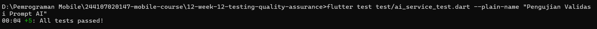
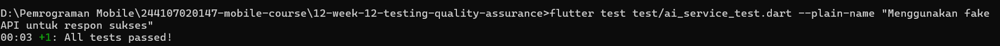
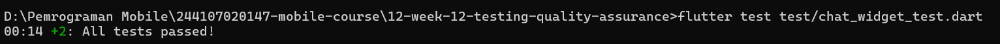
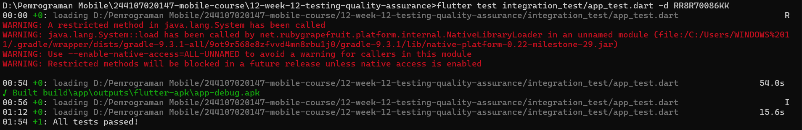
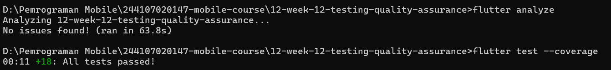

# LAPORAN PRAKTIKUM - WEEK 12 PENGUJIAN DAN JAMINAN KUALITAS

## Identitas Mahasiswa

| Keterangan | Detail |
|---|---|
| Nama | Mufliha Hafsyah Shahieza |
| NIM | 244107020147 |
| Kelas | TI-3G |

---

## Deskripsi Project
Project ini adalah kelanjutan dari Week 11 (Optimasi Performa). Pada Week 12, fokus pekerjaan adalah **Pengujian dan Jaminan Kualitas (QA)**. Prosesnya meliputi pembuatan *Unit Test* (logika), *Dependency Test* (fake repository), *Widget Test* (UI), dan *Integration Test* (alur aplikasi di perangkat fisik).

**Stack:** Flutter, Riverpod, GoRouter, `flutter_test`, `integration_test`.

---

### Ringkasan Pengujian

Menerapkan strategi pengujian berlapis untuk memastikan fitur AI Chat dan validasi input berjalan dengan benar.

#### 1. Unit Test & Uji Logika (Validasi Input)
- **File:** `test/ai_service_test.dart`
- **Skenario:** Menguji fungsi `isValidPrompt` pada `AiService` untuk menolak input kosong.
- **Bukti:** 

#### 2. Uji Dependensi (Fake Repository)
- **Skenario:** Mensimulasikan respons API Gemini tanpa memanggil jaringan sungguhan (fake sukses & error).
- **Bukti:** 

#### 3. Widget Test (UI)
- **File:** `test/chat_widget_test.dart`
- **Skenario:** Memastikan elemen UI pada `ChatScreen` muncul dan berfungsi (input teks & tombol kirim).
- **Bukti:** 

#### 4. Integration Test
- **File:** `integration_test/app_test.dart`
- **Skenario:** Menjalankan aplikasi utama (`main()`) pada perangkat Android fisik (ID: `RR8R70086KK`) dan memastikan aplikasi berhasil dimuat tanpa crash.
- **Bukti:** 

---

### Hasil Pemeriksaan
- **`flutter analyze`:** No issues found! (Bersih).
- **`flutter test --coverage`:** All tests passed! (Laporan cakupan tersimpan di `coverage/lcov.info`).

**Bukti Analyze & Coverage:** 

---

## Refleksi

1. **Bug apa yang paling mungkin terlewat tanpa pengujian yang Anda tulis?** 
Jawaban: 
Bug yang paling mungkin terlewat adalah **input kosong atau spasi pada prompt AI**. Tanpa unit test, pengguna bisa saja mengirim prompt kosong yang membuat API Gemini error. Selain itu, *widget test* membantu mendeteksi jika suatu saat ada perubahan UI yang membuat tombol kirim hilang atau tidak berfungsi.

2. **Bagian mana yang perlu fake, dan bagaimana fake itu membuat pengujian lebih konsisten?** 
Jawaban: 
Bagian yang perlu fake adalah **akses ke API Gemini** (`AiService`). Pemanggilan API sungguhan dalam pengujian akan lambat, mahal, dan tidak konsisten. Dengan adanya fake, respons sukses maupun error dapat disimulasikan secara instan dan berulang, sehingga pengujian menjadi lebih cepat dan stabil.

3. **Apa perbedaan nilai yang diberikan pengujian widget dan pengujian integrasi pada fitur Anda?** 
Jawaban: 
**Widget test** sangat cepat dan berfokus pada *satu komponen* UI (memastikan tombol kirim bisa diklik dan teks muncul). **Integration test** jauh lebih lambat karena menjalankan seluruh aplikasi pada perangkat nyata, tetapi nilainya adalah memastikan *alur utuh* (dari `main()` hingga layar chat tampil) berjalan tanpa crash.