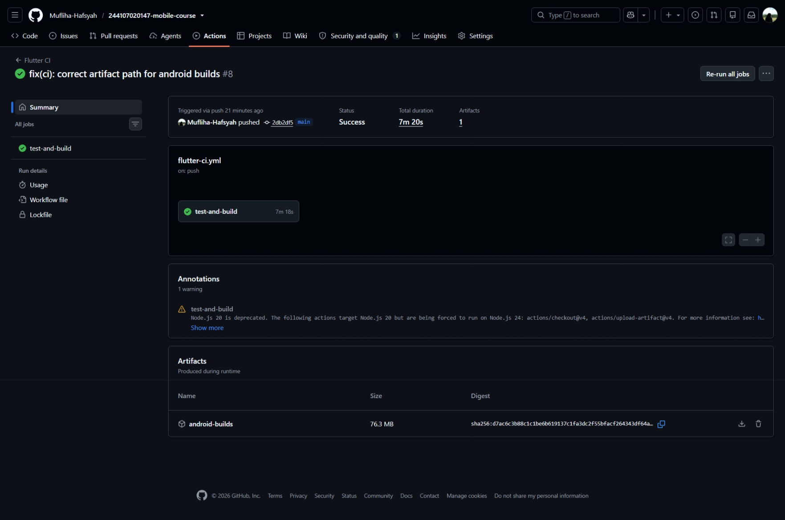

# LAPORAN PRAKTIKUM - WEEK 13 PEMROGRAMAN MOBILE

## Identitas Mahasiswa

| Keterangan | Detail |
|---|---|
| Nama | Mufliha Hafsyah Shahieza |
| NIM | 244107020147 |
| Kelas | TI-3G |

---

## JOBSHEET WEEK 13 CI/CD dan Otomatisasi

---

## Deskripsi Project
Project ini adalah kelanjutan dari Week 12 (Pengujian dan Jaminan Kualitas). Pada Week 13, fokus pekerjaan adalah **CI/CD dan Otomatisasi** menggunakan GitHub Actions. Tujuannya adalah membuat *pipeline* otomatis yang akan mengecek format kode, melakukan analisis statis, menjalankan *test*, dan menghasilkan *artefak* build (APK/AAB) setiap kali ada perubahan kode (*push*) ke repository.

**Stack:** Flutter, Riverpod, GoRouter, `flutter_test`, `integration_test`, GitHub Actions.

---

### Implementasi Workflow CI/CD

Workflow didefinisikan dalam file `.github/workflows/flutter-ci.yml` yang diletakkan di *root* repository. Karena kode Flutter berada di dalam folder `13-week-13-ci-cd-automation`, workflow dikonfigurasi dengan `working-directory` agar perintah Flutter berjalan di lokasi yang tepat.

**Langkah-langkah dalam workflow:**
1. **Setup:** Mengambil *source code* (`actions/checkout`) dan menyiapkan Flutter SDK (`subosito/flutter-action`).
2. **Dependencies:** Menjalankan `flutter pub get`.
3. **Pemeriksaan:** 
   - `dart format --output=none --set-exit-if-changed .` (memastikan format kode konsisten).
   - `flutter analyze --fatal-infos` (analisis statis, gagal jika ada *warning* atau *error*).
4. **Pengujian:** `flutter test --coverage` (menjalankan semua unit, widget, dan integration test yang dibuat di Week 12).
5. **Build:** Menjalankan `flutter build apk --release` dan `flutter build appbundle --release` dengan *flag* `--android-skip-build-dependency-validation` (untuk mengatasi perbedaan versi Gradle).
6. **Artefak:** Mengunggah file APK dan AAB sebagai *artefak* menggunakan `actions/upload-artifact`.

---

### Bukti Hasil dan Evaluasi

Pipeline berhasil dijalankan secara otomatis melalui proses *push* ke branch `main`. Seluruh tahapan (format, analyze, test, build) berjalan sukses (status hijau).

**Detail Hasil CI/CD:**
- **Commit:** `0ccfeea` (menyesuaikan dengan commit terakhir saat build berhasil).
- **Durasi Build:** ~7 menit 20 detik.
- **Artefak:** Berhasil mengunggah 1 artefak (`android-builds`) dengan ukuran 76.3 MB (berisi file `app-release.apk` dan `app-release.aab`).

**Bukti UI (Halaman GitHub Actions):** 

---

### Tugas dan Refleksi

**Tugas:**
1. **Workflow CI:** Berhasil membuat workflow untuk format, analisis, dan test.
2. **Build & Artefak:** Berhasil membangun APK/AAB dan menyimpannya sebagai artefak.
3. **Dokumentasi:** Seluruh proses dan hasil telah didokumentasikan.

### Rencana Versi Berikutnya & Risiko Keamanan

- **Versi Berikutnya:** Saat ini project menggunakan versi `1.0.0+1` (terdapat di `pubspec.yaml`). Untuk rilis berikutnya, *build number* akan dinaikkan (misal menjadi `1.0.0+2`) dan versi semantik akan disesuaikan jika ada fitur baru (misal `1.1.0+3`).
- **Pemeriksaan yang Dijalankan:** Workflow menjalankan pengecekan format (`dart format`), analisis statis (`flutter analyze`), dan pengujian (`flutter test`).
- **Risiko Keamanan yang Perlu Ditangani:**
  1. **Kredensial API (Secrets):** Token atau *API Key* (seperti Gemini API Key) tidak boleh ditulis langsung di kode. Ke depannya, nilai ini akan disuntikkan melalui **GitHub Secrets** dan `--dart-define` saat proses build di CI/CD.
  2. **Penandatanganan Aplikasi (Signing):** *Keystore* untuk merilis aplikasi ke Play Store belum dikonfigurasi di pipeline. Ke depannya, *keystore* harus disimpan sebagai *base64 string* di GitHub Secrets dan hanya diakses pada *workflow* rilis (bukan saat pull request).

---

## Refleksi

1. **Masalah apa yang ditemukan otomatis sebelum perubahan di-merge?** 
Jawaban: 
Pipeline CI secara otomatis mendeteksi **masalah format kode** (file yang belum rapi) dan **versi Gradle yang tidak cocok** saat proses *build*. Tanpa CI, masalah format mungkin tidak akan terdeteksi sampai ada *code review* manual, dan masalah Gradle baru akan ketahuan saat developer mencoba nge-build aplikasi secara lokal atau saat rilis.

2. **Informasi apa yang Anda butuhkan untuk menyelidiki build yang gagal?** 
Jawaban: 
Untuk menyelidiki build yang gagal, informasi yang dibutuhkan adalah **log detail dari langkah yang gagal** (yang bisa diakses di tab Actions). Log ini menunjukkan perintah apa yang dijalankan, *error message* yang muncul, serta baris kode mana yang bermasalah. Selain itu, informasi mengenai versi *dependency* dan *environment* (seperti versi Gradle/Flutter) sangat penting untuk mereproduksi error di lokal.

3. **Bagian mana yang masih perlu persetujuan atau pemeriksaan manual sebelum rilis?** 
Jawaban: 
Meskipun CI/CD sudah otomatis menjalankan test dan build, beberapa hal masih perlu pemeriksaan manual sebelum rilis, antara lain:
- **Penandatanganan aplikasi (Signing):** Konfigurasi *keystore* dan *password* tidak boleh sembarangan ditaruh di workflow (harus pakai GitHub Secrets). Proses ini biasanya butuh verifikasi manual di lingkungan rilis.
- **Uji coba di perangkat fisik:** Artefak APK yang dihasilkan CI tetap harus diuji coba secara manual di perangkat fisik untuk memastikan UI/UX berjalan baik.
- **Review kode (Pull Request):** Manusia tetap perlu meninjau kode untuk memastikan logika bisnis dan *security* sudah sesuai, karena CI tidak bisa menilai niat dan arsitektur kode.